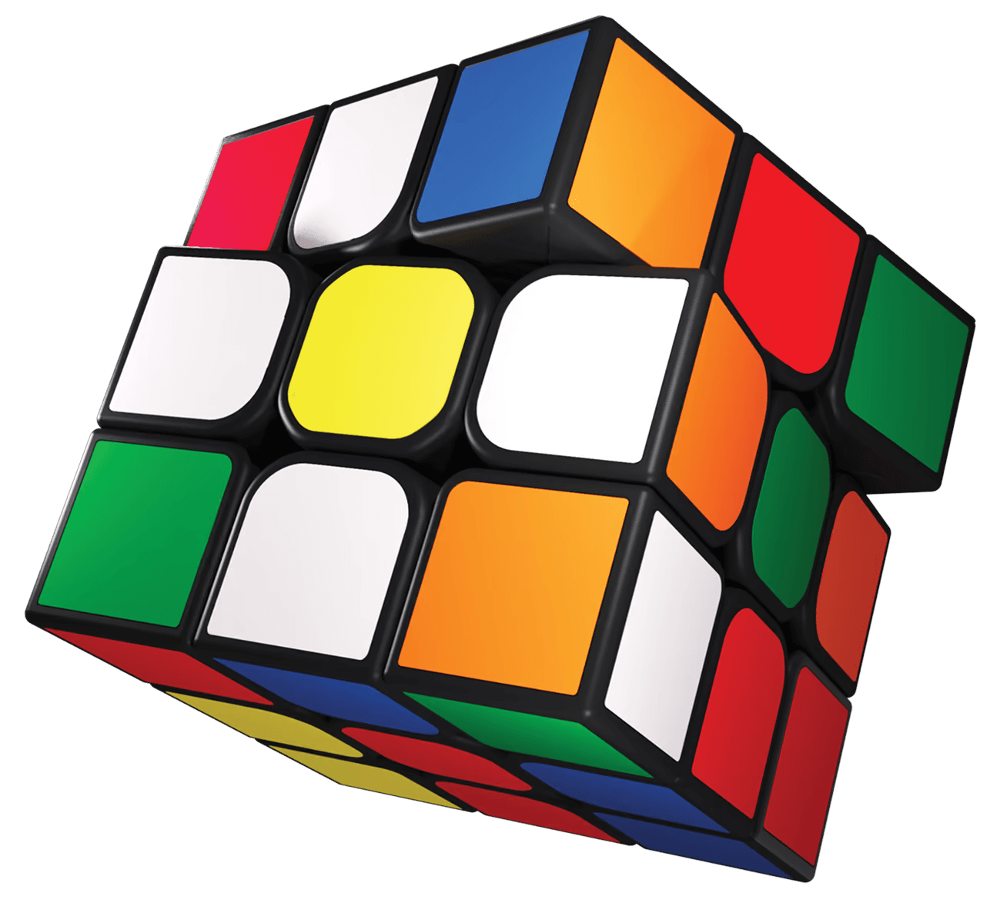

# magic_cube

<div align="center">
  <a href="https://github.com/runoob-coder/flutter-magic-cube" target="_blank" rel="noopener"> 
    
  </a>
</div>

A pure-Flutter 3D Rubik's cube widget: drag a sticker to turn its layer, drag outside the cube to orbit the view, or drive every move from code with standard notation.

[][pub]
[](https://pub.dev/documentation/magic_cube/latest/)
[](https://deepwiki.com/runoob-coder/flutter-magic-cube)
[](https://runoob-coder.github.io/flutter-magic-cube/)
[](https://github.com/runoob-coder/flutter-magic-cube/actions/workflows/deploy_web.yml)
[][repo]

Language: English | [简体中文](https://github.com/runoob-coder/flutter-magic-cube/blob/main/README_CN.md)

> 🖼️ Rendered entirely by `CustomPainter` on a 2D canvas — no 3D engine, no external assets.

## ✨ Features

- 🧊 **Pure Flutter rendering** — perspective projection and depth sorting on a 2D canvas; no third-party libraries, no native plugins, no three.js.
- 👆 **Turn any layer by dragging** — from your drag direction the widget works out the rotation axis, the layer and the turn direction; past 45° it snaps to the nearest 90°.
- 🌍 **Free 360° viewpoint** — a rotation matrix instead of yaw/pitch Euler angles, so drags and inertia never hit gimbal lock and keep the same feel after flipping over the poles.
- 🖐️ **Two-finger orbit** — a second finger switches the gesture to camera rotation and smoothly rolls back the in-progress layer turn.
- 🔤 **Standard notation** — `U D L R F B M E S x y z`, `'` / `2` suffixes, and layer-index prefixes (`3X'`) for odd cubes from 3×3 to 11×11; parsing and printing round-trip at the same `size`.
- 🧠 **Complete state model** — scramble, undo, step-by-step restore, solved detection, solved-face count, history, and `taskEpoch` to mark the state generation.
- 🎨 **Realistic look** — rounded outer corners with corner patches, rounded cubie bodies, raised stickers with side walls and shadows, view-space lighting, and four hot-swappable themes.
- 🖼️ **Centre-piece logo** — print any `ui.Image` on one centre sticker; it follows the cubie, its perspective and its lighting, with helpers for text, icons and the Flutter logo.
- ⚡ **Layer-level caching** — static layers are recorded once as a `Picture` and replayed per frame; geometry, shading and outline caches plus pooled temporaries (~69% less per-frame work in a 400×400 3×3 benchmark).
- 📐 **Pixel-adaptive quality** — rounded outlines tessellate from their on-screen radius (≤0.12 px chord deviation), and side-wall silhouettes get a stencil-free hairline anti-aliasing stroke that works on Web.
- 🧪 **Testable by design** — without a bound `TickerProvider` (e.g. in unit tests) moves apply immediately instead of animating.

## 🚀 Getting started

Install via pub.dev → [pub.dev/packages/magic_cube/install](https://pub.dev/packages/magic_cube/install)

```yaml
dependencies:
  magic_cube: ^1.0.0
```

Run the interactive example locally:

```bash
cd example
flutter pub get
```

### ⚙️ Requirements

- Flutter `>=3.47.0`
- Dart SDK `^3.13.5`

## 📖 Usage

### 🧊 Minimal widget

`MagicCube` sizes itself to its parent (using the shorter available side; 320 px when unconstrained) and creates its own controller automatically:

```dart
import 'package:flutter/widgets.dart';
import 'package:magic_cube/magic_cube.dart';

class CubeDemo extends StatelessWidget {
  const CubeDemo({super.key});

  @override
  Widget build(BuildContext context) => const Center(
        child: SizedBox(width: 320, height: 320, child: MagicCube()),
      );
}
```

### 🎮 Programmatic moves

Pass your own controller when moves need to be driven from code:

```dart
final MagicCubeController controller = MagicCubeController();

await controller.applyMove(CubeMove.parse("R'"));            // one move
await controller.applyMoves(CubeMove.parseSequence('R U R2'));
await controller.applyNotation("R U R' U'");                // algorithm
await controller.scramble(length: 25);                     // random scramble
await controller.undo();                                   // one step back
await controller.undoAll();                                // restore step by step
await controller.resetView();                              // animate the view home
controller.reset();                                        // solve + clear history

MagicCube(controller: controller);                          // dispose() the controller yourself
```

`MagicCubeController` extends `ChangeNotifier`, so `ListenableBuilder` can rebuild whenever the state changes. `MagicCube` attaches its own `TickerProvider` automatically, letting an external controller safely outlive the widget. When several widgets share one controller, `unbind(vsync)` detaches only that widget's ticker.

> [!NOTE]
> An interrupted `await scramble()` / `undoAll()` still completes normally, but `taskEpoch` changes. History is trimmed once `maxHistory` (500) is exceeded, and each undo entry is removed only after its inverse move really settles.

### 👆 Gestures

| Gesture | Result |
| --- | --- |
| Drag on a sticker | Turns the touched layer, tracking the finger; snaps to 90° past 45° |
| Drag outside the cube | Orbits the whole cube freely, with friction-based inertia on release |
| Second finger down | Switches to camera rotation; the in-progress layer turn is animated back to 0 |
| Two fingers move together | Orbit follows the midpoint (each finger contributes half the delta) |
| `applyMove` / `applyNotation` | Queued and animated serially, never interleaved with a gesture turn |

### 🌍 Viewpoint

```dart
controller.orbitBy(dx: 0.1, dy: -0.05);               // rotate around screen axes (radians)
final Mat3 view = controller.viewRotation;            // exact orientation
controller.setViewRotation(view);                     // restore an exact pose
controller.setViewAngles(yaw: 0.3, pitch: 0.5);      // yaw/pitch (discards roll)
await controller.animateViewTo(yaw: 0, pitch: 0.5);  // shortest-path animation
await controller.animateViewToRotation(view);
await controller.resetView();
```

`yaw` / `pitch` are closest decompositions of the current matrix — good for display, not for restoring an exact pose. `onViewChanged` reports them as a `CubeView`.

### 🎨 Themes

```dart
MagicCube(theme: CubeTheme.classic());
MagicCube(theme: CubeTheme.pastel());
MagicCube(theme: CubeTheme.neon().copyWith(lighting: false));
MagicCube(theme: const CubeTheme.flat());   // no thickness, side shading or shadow

const CubeTheme(
  gap: 0.055,
  outerCornerRadius: 0.5,   // the 8 outer corners of the whole cube
  bodyCornerRadius: 0.15,   // every other cubie corner
  stickerThickness: 0.04,
  stickerShadowBlur: 0,
  ambient: 0.62,
  diffuse: 0.42,
  lighting: true,           // false = colours stay constant while turning
);
```

### 🖼️ Centre-piece logo


```dart
import 'dart:ui' as ui;
import 'package:magic_cube/magic_cube.dart';

final ui.Image logo = await renderFlutterLogoToImage(size: 256);

MagicCube(
  centerLogo: logo,        // shortcut for theme.centerLogo
  logoFace: kFaceUp,       // default: the white face
  logoScale: 0.75,         // fraction of the sticker's side
);
```

Three rasterisation helpers are exported:

```dart
// yourIconData comes from an icon font package added to your app's dependencies
await renderTextToImage('R', color: const ui.Color(0xFF1B1B1B));
await renderIconToImage(yourIconData, color: const ui.Color(0xFF1B1B1B));
await renderFlutterLogoToImage();
```

All three return a square, centred, transparent `ui.Image` that sits on any sticker colour. You can also set the logo on the theme: `CubeTheme(centerLogo: ...)`, `copyWith(centerLogo: ...)` or `withLogo(...)`. `copyWith(centerLogo: null)` clears an inherited logo, while in `withLogo` a `null` means "keep the current one".

> [!NOTE]
> `renderIconToImage` needs the icon's font package to be a dependency of your app, otherwise the glyph silently rasterises blank. `CubeTheme` never disposes the image — the caller owns its lifetime.

### 🧩 Larger cubes & notation

```dart
final MagicCubeController controller = MagicCubeController(size: 5);

final CubeMove inner = CubeMove.parse("3X'", size: 5);  // layer 3 around the x axis
final String token = inner.notation(size: 5);           // round-trips to "3X'"
final List<CubeMove> moves = CubeMove.randomScramble(length: 20, size: 5);
```

Odd sizes from 3 to `kMaxCubeSize` (11) are accepted and validated at runtime. Face letters always mean the outer layer, `M E S` the middle slice, and any other slice uses a numeric layer prefix. `applyNotation` and `scramble` already use `state.size`. Invalid tokens such as `R5` throw `FormatException`.

### 📡 Callbacks & state

```dart
MagicCube(
  controller: controller,
  onMove: (CubeMove move) => print(move.notation(size: controller.state.size)),
  onViewChanged: (CubeView view) => print('${view.yaw}, ${view.pitch}'),
);

controller.isSolved;          // false while a turn is in progress
controller.solvedFaceCount;   // 0...6
controller.moveCount;
controller.isIdle;
final List<Cubie> cubies = controller.state.cubies;   // unmodifiable view
```

`onMove` fires exactly when a **gesture** turn settles; programmatic moves keep their own semantics. `onMoveCommitted` is available when wiring the controller without the widget.

### ⚙️ Fine-tuning

```dart
MagicCube(
  interactive: false,             // disable all gestures
  enableLayerTurns: false,        // allow orbiting only
  inertia: false,
  dragThreshold: 12,              // logical pixels
  orbitSensitivity: 0.006,        // radians per pixel
  turnSensitivity: 0.8,           // 1 = sticker tracks the finger exactly
  turnDuration: const Duration(milliseconds: 300),
  turnCurve: Curves.easeOut,
  zoom: 1.2,
  cameraDistance: 8,
);
```

## 📚 [API reference](https://pub.dev/documentation/magic_cube/latest/)

### 🧩 [MagicCube](https://pub.dev/documentation/magic_cube/latest/magic_cube/MagicCube-class.html)

| Property | Type | Default | Description |
| --- | --- | --- | --- |
| `controller` | `MagicCubeController?` | `null` | External controller; created and disposed internally when omitted. |
| `theme` | `CubeTheme` | `CubeTheme()` | Colours and geometry. |
| `centerLogo` | `ui.Image?` | `null` | Shortcut for `theme.centerLogo`; caller owns/disposes the image. |
| `logoFace` | `int?` | `null` | Shortcut for `theme.logoFace` (`kFaceUp` etc.). |
| `logoScale` | `double?` | `null` | Shortcut for `theme.logoScale` (0...1). |
| `zoom` | `double` | `1` | Extra zoom; 1 fills the available short side. |
| `cameraDistance` | `double` | `9.5` | Smaller = stronger perspective. |
| `fitRadius` | `double` | `2.45` | World radius mapped to the canvas short side. |
| `interactive` | `bool` | `true` | Handle gestures at all. |
| `enableLayerTurns` | `bool` | `true` | Allow dragging stickers to turn a layer. |
| `enableWholeRotation` | `bool` | `true` | Allow orbiting the whole cube. |
| `inertia` | `bool` | `true` | Continue orbiting after release. |
| `dragThreshold` | `double` | `8` | Minimum drag distance before a gesture starts. |
| `orbitSensitivity` | `double` | `0.0075` | Radians per pixel of orbit drag. |
| `turnSensitivity` | `double` | `1` | Layer-turn tracking factor. |
| `inertiaFriction` | `double` | `7` | Decay rate (1/s); total travel is velocity / friction. |
| `inertiaDuration` | `Duration` | `520 ms` | Duration of the inertial glide. |
| `maxInertiaVelocity` | `double` | `8` | Velocity cap in rad/s. |
| `turnDuration` | `Duration?` | `null` | Per-widget override of the settle tween; `null` uses the controller. |
| `turnCurve` | `Curve?` | `null` | Per-widget override of the settle curve. |
| `onMove` | `ValueChanged<CubeMove>?` | `null` | Called only when a gesture turn commits. |
| `onViewChanged` | `ValueChanged<CubeView>?` | `null` | Called on yaw/pitch changes. |

### 🎛️ [MagicCubeController](https://pub.dev/documentation/magic_cube/latest/magic_cube/MagicCubeController-class.html)

| Constructor argument | Type | Default | Description |
| --- | --- | --- | --- |
| `size` | `int` | `3` | Odd cube order, 3...`kMaxCubeSize` (11). |
| `turnDuration` | `Duration` | `220 ms` | Default duration of one move animation. |
| `turnCurve` | `Curve` | `Curves.easeInOutCubic` | Default settle curve. |
| `viewDuration` | `Duration` | `320 ms` | Default viewpoint animation duration. |
| `maxHistory` | `int` | `500` | Oldest moves are dropped beyond this. |
| `yaw` | `double?` | `null` → `-0.62` | Initial yaw (`defaultYaw`). |
| `pitch` | `double?` | `null` → `0.45` | Initial pitch (`defaultPitch`). |

| Member | Description |
| --- | --- |
| `applyMove` / `applyMoves` / `applyNotation` / `scramble` | Queue and animate moves; all return awaitable `Future<void>`. |
| `undo` / `undoAll` / `clearHistory` / `reset` / `stopAnimation` | History and lifecycle control. |
| `beginTurn` / `updateTurn` / `endTurn` / `cancelTurn` | Manual gesture-driven turns (used by `MagicCube`). |
| `orbitBy` / `setViewRotation` / `setViewAngles` / `animateViewTo` / `animateViewToRotation` / `resetView` | Viewpoint control. |
| `bind` / `unbind` | Attach or detach a `TickerProvider`; unbound moves apply immediately. |
| `state` / `turn` / `turnAngle` / `viewRotation` / `yaw` / `pitch` | Current logical and viewpoint state. |
| `isSolved` / `solvedFaceCount` / `history` / `moveCount` / `isIdle` / `isDragging` / `isAnimating` / `taskEpoch` / `isDisposed` | Observable state flags and counters. |
| `onMoveCommitted` | Low-level callback fired exactly once per committed gesture move. |


### 🎨 [CubeTheme](https://pub.dev/documentation/magic_cube/latest/magic_cube/CubeTheme-class.html)

| Property | Type | Default | Description |
| --- | --- | --- | --- |
| `up` / `down` / `left` / `right` / `front` / `back` | `Color` | classic scheme | Sticker colours per face. |
| `body` | `Color` | `0xFF141414` | Plastic body / gaps. |
| `gap` | `double` | `0.055` | Gap between cubies, in cubie-pitch units. |
| `stickerScale` | `double` | `0.84` | Sticker size relative to the face. |
| `stickerRadius` | `double` | `0.3` | Sticker corner radius, fraction of its half-width. |
| `outerCornerRadius` | `double` | `0.5` | Radius of the cube's 8 outer corners. |
| `bodyCornerRadius` | `double` | `0.15` | Radius of all other cubie corners. |
| `stickerThickness` | `double` | `0.04` | Lift along the normal; clamped to `maxStickerThickness` (0.15). |
| `stickerSideShade` | `double` | `0.72` | Brightness of the side walls (0...1). |
| `stickerShadowOpacity` | `double` | `0.34` | Shadow opacity; 0 disables it. |
| `stickerShadowOffset` | `double` | `0.1` | Offset, fraction of the sticker half-width; clamped to 0.35. |
| `stickerShadowBlur` | `double` | `0` | Gaussian blur radius in px (costly; keep 0 on Web). |
| `ambient` / `diffuse` | `double` | `0.62` / `0.42` | Body lighting. |
| `stickerAmbient` / `stickerDiffuse` | `double` | `0.66` / `0.4` | Sticker lighting. |
| `lighting` | `bool` | `true` | `false` keeps colours constant while turning. |
| `centerLogo` | `ui.Image?` | `null` | Image printed on one centre sticker. |
| `logoFace` | `int` | `kFaceUp` | Which face's centre cubie carries the logo. |
| `logoScale` | `double` | `0.75` | Logo side as a fraction of the sticker. |

Presets: `CubeTheme.classic()`, `.pastel()`, `.neon()`, `.flat()`. `copyWith` overrides fields (an explicit `centerLogo: null` clears the logo); `withLogo` applies only the three logo shortcuts; `faceColors` returns the six colours in face-index order. Equality covers every rendering field because painters key their caches by the theme object.

### 🔤 [Notation, state & rendering helpers](https://pub.dev/documentation/magic_cube/latest/magic_cube/)

| Symbol | Purpose |
| --- | --- |
| `CubeMove` / `CubeTurn` | A completed quarter-turn move / an in-progress turn with an arbitrary angle. |
| `CubeMove.parse` / `parseSequence` / `randomScramble` / `notation` | Notation parsing, generation and round-tripping. |
| `CubeState` | `size³` cubies, `applyMove`, `reset`, `isSolved`, `solvedFaceCount`, `revision`, `centerCubieIndices`. |
| `Cubie`, `Vec3`, `Mat3`, `CubeAxis`, `kFace*` | Geometry primitives and face constants. |
| `CubeScene`, `SceneFace`, `SceneHit`, `CubePainter` | Per-frame projected geometry, hit testing and painting; `disposeCaches()` / `disposeSceneCache()` release native resources. |
| `renderTextToImage` / `renderIconToImage` / `renderFlutterLogoToImage` | Rasterise text, an `IconData` or the Flutter logo into a square transparent `ui.Image`. |
| `kMaxCubeSize`, `validateCubeSize` | Size limit (11) and the shared runtime validator. |

## 🧪 Testing

```bash
flutter analyze
flutter test
cd example && flutter analyze && flutter test
```

The suite covers matrix precision, solved detection, notation round-tripping (including higher orders), controller lifecycle and epochs, free viewpoint behaviour, layer sorting (no poke-through), gestures, corner patches, logo perspective and anti-aliasing.

> [!NOTE]
> Most paint tests draw into a `PictureRecorder` and compare recorded command sizes, so headless CI needs no GPU snapshots. The anti-aliasing tests do rasterise one frame and compare against a 4× supersampled reference; keep `toImage()` calls minimal in this environment.

## ℹ️ Additional information

- 📦 **Repository**: [github.com/runoob-coder/flutter-magic-cube][repo]
- 🐛 **Issues**: [github.com/runoob-coder/flutter-magic-cube/issues](https://github.com/runoob-coder/flutter-magic-cube/issues)
- 🎬 **Example app**: `example/` — double-tap to scramble and start the timer, automatic stop + time recording, ao5/ao12 statistics, notation input, theme switching, auto-rotation, logo size slider, and English/Simplified-Chinese localisation.
- 🤝 **Contributions**: issues and pull requests are welcome!
- 🔗 **Solve guide**: [rubiks.com/solve-guide](https://rubiks.com/solve-guide)

## 💛 Support

If `magic_cube` helps you build something fun, a star or a like takes only a second and helps other Flutter developers find it.

- ⭐ [Star on GitHub][repo]
- 👍 [Like on pub.dev][pub]

## [☕️ Buy Me a Coffee](https://www.noob-coder.com/buy-me-a-coffee)

| Buy Me a Coffee | Donate with PayPal |
| :---: | :---: |
| <a href="https://ko-fi.com/noob_coder" target="_blank" rel="noopener"></a> | <a href="https://paypal.me/runoobcoder" target="_blank" rel="noopener"></a> |

[repo]: https://github.com/runoob-coder/flutter-magic-cube
[pub]: https://pub.dev/packages/magic_cube
