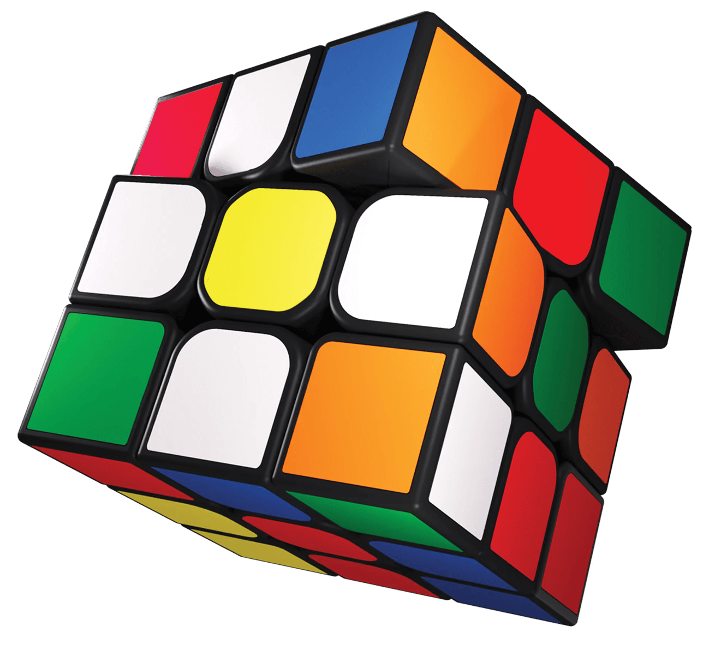

# 3D魔方

<div align="center">
  <a href="https://runoob-coder.github.io/flutter-magic-cube" target="_blank" rel="noopener"> 
    
  </a>
</div>

纯 Flutter 实现的三维魔方组件：拖拽贴纸即可拧动对应层，在魔方之外拖拽可自由旋转视角，也能用标准记号从代码驱动每一步转动。

[][pub]
[](https://pub-web.flutter-io.cn/documentation/magic_cube/latest/)
[](https://deepwiki.com/runoob-coder/flutter-magic-cube)
[](https://runoob-coder.github.io/flutter-magic-cube/)
[](https://github.com/runoob-coder/flutter-magic-cube/actions/workflows/deploy_web.yml)
[][repo]

Language: [English](README.md) | 简体中文

> 🖼️ 全部由 `CustomPainter` 在 2D Canvas 上绘制 —— 不依赖 3D 引擎，也不需要外部素材。

## ✨ 特性

- 🧊 **纯 Flutter 渲染** —— 在 2D 画布上完成透视投影与深度排序，零三方依赖、零原生插件、不用 three.js。
- 👆 **拖拽拧动任意层** —— 根据拖拽方向自动判定旋转轴、目标层与转向，超过 45° 自动对齐到最近的 90°。
- 🌍 **360° 自由视角** —— 用旋转矩阵而非「偏航 + 俯仰」欧拉角，翻过顶部 / 底部也不会万向锁，拖拽手感始终一致。
- 🖐️ **双指旋转视角** —— 第二根手指落下时切换为视角旋转，并把正在拧的那一层平滑回滚。
- 🔤 **标准记号** —— 支持 `U D L R F B M E S x y z`、`'` / `2` 后缀，以及高阶内层的层号前缀（`3X'`）；3×3 到 11×11 奇数阶，`parse` 与 `notation` 在同一 `size` 下可逆。
- 🧠 **完整状态模型** —— 打乱、撤销、逐步还原、复原判定、已复原面数、历史记录，以及用于标识状态世代的 `taskEpoch`。
- 🎨 **拟真外观** —— 最外层 8 个角的圆角补丁、每个小方块的圆角、带侧壁与阴影的立体贴片、视图空间光照，四款主题可运行时热切换。
- 🖼️ **中心块 logo** —— 把任意 `ui.Image` 印在某一张中心贴纸上，跟随小方块转动、透视与明暗；提供文字、图标与 Flutter 标志的栅格化工具。
- ⚡ **按层缓存** —— 静止层一次录成 `Picture` 后逐帧回放，几何 / 着色 / 轮廓缓存配合对象池复用（400×400 三阶基准测试约节省 69% 的单帧开销）。
- 📐 **按像素自适应画质** —— 圆角轮廓按屏幕像素半径细分（弦高 ≤0.12 px）；侧壁剪影用零宽度 hairline 描边补抗锯齿（不依赖 stencil，Web 同样有效）。
- 🧪 **天然可测试** —— 未绑定 `TickerProvider` 时（例如单元测试）转动立即生效，不播放动画。

## 🚀 快速开始

通过 pub.dev 安装 → [pub-web.flutter-io.cn/packages/magic_cube/install](https://pub-web.flutter-io.cn/packages/magic_cube/install)

```yaml
dependencies:
  magic_cube: ^1.0.0
```

本地运行完整示例：

```bash
cd example
flutter pub get
```

### ⚙️ 环境要求

- Flutter `>=3.47.0`
- Dart SDK `^3.13.5`

## 📖 使用示例

### 🧊 最小用法

`MagicCube` 会自动按父级可用空间决定边长（取宽高较小值；若两个方向均无约束则默认 320 像素），并自行创建与释放内部控制器：

```dart
import 'package:flutter/widgets.dart';
import 'package:magic_cube/magic_cube.dart';

class CubeDemo extends StatelessWidget {
  const CubeDemo({super.key});

  @override
  Widget build(BuildContext context) => const Center(
        child: SizedBox(width: 320, height: 320, child: MagicCube()),
      );
}
```

### 🎮 编程转动

需要从代码驱动转动时传入自己的控制器：

```dart
final MagicCubeController controller = MagicCubeController();

await controller.applyMove(CubeMove.parse("R'"));            // 单步
await controller.applyMoves(CubeMove.parseSequence('R U R2'));
await controller.applyNotation("R U R' U'");                // 公式
await controller.scramble(length: 25);                     // 随机打乱
await controller.undo();                                   // 撤销一步
await controller.undoAll();                                // 逐步还原
await controller.resetView();                              // 视角动画复位
controller.reset();                                        // 立即复原并清空历史

MagicCube(controller: controller);                          // 控制器需自行 dispose()
```

`MagicCubeController` 继承自 `ChangeNotifier`，状态变更时可通过 `ListenableBuilder` 触发重建。`MagicCube` 会自行绑定 / 解绑其 `TickerProvider`，因此外部控制器可独立于组件生命周期存续。当多个组件共享同一控制器时，`unbind(vsync)` 仅解绑当前组件的 Ticker，不影响其余组件。

> [!NOTE]
> 被 `stopAnimation()` / `reset()` / `dispose()` 打断的 `await scramble()` / `undoAll()` 仍会正常结束，但 `taskEpoch` 会变化。历史超过 `maxHistory`（默认 500）后丢弃最早的转动；撤销记录只在对应逆转动真正落定后才移除。

### 👆 交互手势

| 操作 | 效果 |
| --- | --- |
| 在贴纸上拖拽 | 拧动被触摸的那一层，方向跟随手指，超过 45° 自动对齐到 90° |
| 在魔方之外的空白处拖拽 | 整体自由旋转，松手后按摩擦模型惯性衰减 |
| 第二根手指落下 | 切换为视角旋转，正在进行的拧层补间回滚到 0 |
| 双指一起移动 | 视角跟随两指中点（每根手指贡献一半位移） |
| `applyMove` / `applyNotation` | 转动自动排队串行播放，不会与手势转动互相覆盖 |

### 🌍 视角控制

```dart
controller.orbitBy(dx: 0.1, dy: -0.05);               // 绕屏幕轴增量旋转（弧度）
final Mat3 view = controller.viewRotation;            // 精确姿态矩阵
controller.setViewRotation(view);                     // 恢复精确姿态
controller.setViewAngles(yaw: 0.3, pitch: 0.5);      // 偏航 / 俯仰（会丢掉滚转分量）
await controller.animateViewTo(yaw: 0, pitch: 0.5);  // 最短路径动画
await controller.animateViewToRotation(view);
await controller.resetView();
```

`yaw` / `pitch` 只是当前矩阵最接近的分解值，适合显示与比较，不能用来精确存回姿态；`onViewChanged` 会以 `CubeView` 带出这两个角。

### 🎨 主题与外观

```dart
MagicCube(theme: CubeTheme.classic());
MagicCube(theme: CubeTheme.pastel());
MagicCube(theme: CubeTheme.neon().copyWith(lighting: false));
MagicCube(theme: const CubeTheme.flat());   // 关闭厚度、侧壁明暗与阴影

const CubeTheme(
  gap: 0.055,
  outerCornerRadius: 0.5,   // 魔方整体最外层 8 个角
  bodyCornerRadius: 0.15,   // 其余所有小方块的角
  stickerThickness: 0.04,
  stickerShadowBlur: 0,
  ambient: 0.62,
  diffuse: 0.42,
  lighting: true,           // false：转动时同一颜色保持满亮度
);
```

### 🖼️ 中心块 logo


```dart
import 'dart:ui' as ui;
import 'package:magic_cube/magic_cube.dart';

final ui.Image logo = await renderFlutterLogoToImage(size: 256);

MagicCube(
  centerLogo: logo,        // theme.centerLogo 的快捷参数
  logoFace: kFaceUp,       // 默认贴在白色面
  logoScale: 0.75,         // 占贴纸边长的比例
);
```

包内导出三个栅格化工具：

```dart
// yourIconData 来自你的 App 已依赖的图标字体包
await renderTextToImage('R', color: const ui.Color(0xFF1B1B1B));
await renderIconToImage(yourIconData, color: const ui.Color(0xFF1B1B1B));
await renderFlutterLogoToImage();
```

三个工具都返回居中、透明的正方形 `ui.Image`，可印在任何底色的贴纸上。也可以直接通过主题设置 logo：`CubeTheme(centerLogo: ...)`、`copyWith(centerLogo: ...)` 或 `withLogo(...)`。`copyWith(centerLogo: null)` 会清掉继承来的 logo；而 `withLogo` 里的 `null` 表示「沿用当前 logo」。

> [!NOTE]
> `renderIconToImage` 要求图标所属字体包是你的 App 的依赖，否则字形会静默栅格化成空白。`CubeTheme` 不会 dispose 这张图片，生命周期由调用方负责。

### 🧩 高阶魔方与记号

```dart
final MagicCubeController controller = MagicCubeController(size: 5);

final CubeMove inner = CubeMove.parse("3X'", size: 5);  // 绕 x 轴的第 3 层
final String token = inner.notation(size: 5);           // 可逆回 "3X'"
final List<CubeMove> moves = CubeMove.randomScramble(length: 20, size: 5);
```

支持 3 到 `kMaxCubeSize`（11）之间的奇数阶，并在运行时校验。面字母始终表示最外层，`M E S` 表示正中层，其余内层用「层号前缀 + 轴字母」；`applyNotation` 与 `scramble` 已自动使用 `state.size`。`R5` 这类非法记号会抛 `FormatException`。

### 📡 回调与状态

```dart
MagicCube(
  controller: controller,
  onMove: (CubeMove move) => print(move.notation(size: controller.state.size)),
  onViewChanged: (CubeView view) => print('${view.yaw}, ${view.pitch}'),
);

controller.isSolved;          // 转动进行中不算复原
controller.solvedFaceCount;   // 0...6
controller.moveCount;
controller.isIdle;
final List<Cubie> cubies = controller.state.cubies;   // 只读视图
```

`onMove` 只在**手势**转动真正落定时触发，编程转动保持原有语义；不借助 widget 直接使用控制器时，可用 `onMoveCommitted`。

### ⚙️ 精细调节

```dart
MagicCube(
  interactive: false,             // 关闭全部手势
  enableLayerTurns: false,        // 只允许旋转视角
  inertia: false,
  dragThreshold: 12,              // 逻辑像素
  orbitSensitivity: 0.006,        // 弧度 / 像素
  turnSensitivity: 0.8,           // 1 表示贴纸完全跟手
  turnDuration: const Duration(milliseconds: 300),
  turnCurve: Curves.easeOut,
  zoom: 1.2,
  cameraDistance: 8,
);
```

## 📚 [API 参考](https://pub-web.flutter-io.cn/documentation/magic_cube/latest/)

### 🧩 [MagicCube](https://pub-web.flutter-io.cn/documentation/magic_cube/latest/magic_cube/MagicCube-class.html)

| 参数 | 类型 | 默认值 | 说明 |
| --- | --- | --- | --- |
| `controller` | `MagicCubeController?` | `null` | 外部控制器；不传时内部创建并释放。 |
| `theme` | `CubeTheme` | `CubeTheme()` | 配色与几何观感。 |
| `centerLogo` | `ui.Image?` | `null` | `theme.centerLogo` 的快捷参数；图片由调用方管理 / 释放。 |
| `logoFace` | `int?` | `null` | `theme.logoFace` 的快捷参数（`kFaceUp` 等）。 |
| `logoScale` | `double?` | `null` | `theme.logoScale` 的快捷参数（0...1）。 |
| `zoom` | `double` | `1` | 额外缩放；1 表示正好铺满可用短边。 |
| `cameraDistance` | `double` | `9.5` | 相机距离，越小透视越强。 |
| `fitRadius` | `double` | `2.45` | 映射到画布短边的世界半径。 |
| `interactive` | `bool` | `true` | 是否响应手势。 |
| `enableLayerTurns` | `bool` | `true` | 是否允许拖拽贴纸拧层。 |
| `enableWholeRotation` | `bool` | `true` | 是否允许整体旋转视角。 |
| `inertia` | `bool` | `true` | 松手后是否继续惯性滑行。 |
| `dragThreshold` | `double` | `8` | 判定为拖拽的最小位移。 |
| `orbitSensitivity` | `double` | `0.0075` | 整体旋转灵敏度（弧度 / 像素）。 |
| `turnSensitivity` | `double` | `1` | 拧层跟手系数。 |
| `inertiaFriction` | `double` | `7` | 衰减速率（1/秒）；总位移为速度 / 该值。 |
| `inertiaDuration` | `Duration` | `520 ms` | 惯性动画时长。 |
| `maxInertiaVelocity` | `double` | `8` | 初速度上限（弧度 / 秒）。 |
| `turnDuration` | `Duration?` | `null` | 组件级覆盖落定动画时长；`null` 用控制器的值。 |
| `turnCurve` | `Curve?` | `null` | 组件级覆盖落定曲线。 |
| `onMove` | `ValueChanged<CubeMove>?` | `null` | 仅在手势转动落定时回调。 |
| `onViewChanged` | `ValueChanged<CubeView>?` | `null` | 偏航 / 俯仰变化时回调。 |

### 🎛️ [MagicCubeController](https://pub-web.flutter-io.cn/documentation/magic_cube/latest/magic_cube/MagicCubeController-class.html)

| 构造参数 | 类型 | 默认值 | 说明 |
| --- | --- | --- | --- |
| `size` | `int` | `3` | 奇数阶，3...`kMaxCubeSize`（11）。 |
| `turnDuration` | `Duration` | `220 ms` | 单步转动动画默认时长。 |
| `turnCurve` | `Curve` | `Curves.easeInOutCubic` | 默认落定曲线。 |
| `viewDuration` | `Duration` | `320 ms` | 视角动画默认时长。 |
| `maxHistory` | `int` | `500` | 超出后丢弃最早的转动。 |
| `yaw` | `double?` | `null` → `-0.62` | 初始偏航角（`defaultYaw`）。 |
| `pitch` | `double?` | `null` → `0.45` | 初始俯仰角（`defaultPitch`）。 |

| 成员 | 说明 |
| --- | --- |
| `applyMove` / `applyMoves` / `applyNotation` / `scramble` | 排队并播放转动，均返回可等待的 `Future<void>`。 |
| `undo` / `undoAll` / `clearHistory` / `reset` / `stopAnimation` | 历史与生命周期控制。 |
| `beginTurn` / `updateTurn` / `endTurn` / `cancelTurn` | 手动手势转动接口（`MagicCube` 内部使用）。 |
| `orbitBy` / `setViewRotation` / `setViewAngles` / `animateViewTo` / `animateViewToRotation` / `resetView` | 视角控制。 |
| `bind` / `unbind` | 绑定 / 解绑 `TickerProvider`；未绑定时转动立即生效。 |
| `state` / `turn` / `turnAngle` / `viewRotation` / `yaw` / `pitch` | 当前逻辑状态与视角。 |
| `isSolved` / `solvedFaceCount` / `history` / `moveCount` / `isIdle` / `isDragging` / `isAnimating` / `taskEpoch` / `isDisposed` | 可观察的状态标志与计数。 |
| `onMoveCommitted` | 底层回调：每次手势转动落定恰好触发一次。 |


### 🎨 [CubeTheme](https://pub-web.flutter-io.cn/documentation/magic_cube/latest/magic_cube/CubeTheme-class.html)

| 字段 | 类型 | 默认值 | 说明 |
| --- | --- | --- | --- |
| `up` / `down` / `left` / `right` / `front` / `back` | `Color` | 经典配色 | 六个面的贴纸颜色。 |
| `body` | `Color` | `0xFF141414` | 塑料本体 / 缝隙颜色。 |
| `gap` | `double` | `0.055` | 小方块之间的缝隙，单位为小方块间距。 |
| `stickerScale` | `double` | `0.84` | 贴纸相对整块面的缩放比例。 |
| `stickerRadius` | `double` | `0.3` | 贴纸圆角，单位为贴纸半宽的比例。 |
| `outerCornerRadius` | `double` | `0.5` | 魔方最外层 8 个角的圆角半径。 |
| `bodyCornerRadius` | `double` | `0.15` | 其余所有小方块角的圆角半径。 |
| `stickerThickness` | `double` | `0.04` | 沿法向量的抬起量，上限 `maxStickerThickness`（0.15）。 |
| `stickerSideShade` | `double` | `0.72` | 侧壁相对顶面的亮度系数（0...1）。 |
| `stickerShadowOpacity` | `double` | `0.34` | 阴影透明度，0 表示不画。 |
| `stickerShadowOffset` | `double` | `0.1` | 阴影偏移，单位为贴纸半宽比例，上限 0.35。 |
| `stickerShadowBlur` | `double` | `0` | 高斯模糊半径（像素，开销较高；Web 建议保持 0）。 |
| `ambient` / `diffuse` | `double` | `0.62` / `0.42` | 本体环境光 / 漫反射强度。 |
| `stickerAmbient` / `stickerDiffuse` | `double` | `0.66` / `0.4` | 贴纸环境光 / 漫反射强度。 |
| `lighting` | `bool` | `true` | `false` 时转动过程中颜色深浅保持不变。 |
| `centerLogo` | `ui.Image?` | `null` | 印在中心贴纸上的图片。 |
| `logoFace` | `int` | `kFaceUp` | 哪个面的中心块带 logo。 |
| `logoScale` | `double` | `0.75` | logo 边长占贴纸边长的比例。 |

预设：`CubeTheme.classic()`、`.pastel()`、`.neon()`、`.flat()`。`copyWith` 覆盖指定字段（显式传 `centerLogo: null` 可清空 logo）；`withLogo` 只覆盖三个 logo 快捷参数；`faceColors` 按面索引顺序返回六种颜色。相等性判断覆盖全部参与渲染的字段，因为绘制层以主题对象作为缓存键。

### 🔤 [记号、状态与渲染工具](https://pub-web.flutter-io.cn/documentation/magic_cube/latest/magic_cube/)

| 符号 | 用途 |
| --- | --- |
| `CubeMove` / `CubeTurn` | 一次完整的 90° 倍数转动 / 任意角度的进行中转动。 |
| `CubeMove.parse` / `parseSequence` / `randomScramble` / `notation` | 记号解析、生成与可逆输出。 |
| `CubeState` | `size³` 个小方块，`applyMove`、`reset`、`isSolved`、`solvedFaceCount`、`revision`、`centerCubieIndices`。 |
| `Cubie`、`Vec3`、`Mat3`、`CubeAxis`、`kFace*` | 几何基础类型与面常量。 |
| `CubeScene`、`SceneFace`、`SceneHit`、`CubePainter` | 每帧投影几何、命中测试与绘制；`disposeCaches()` / `disposeSceneCache()` 释放 native 资源。 |
| `renderTextToImage` / `renderIconToImage` / `renderFlutterLogoToImage` | 把文字、`IconData` 或 Flutter 标志栅格化为正方形透明 `ui.Image`。 |
| `kMaxCubeSize`、`validateCubeSize` | 阶数上限（11）与共用的运行时校验。 |

## 🧪 测试

```bash
flutter analyze
flutter test
cd example && flutter analyze && flutter test
```

测试覆盖矩阵精度、复原判定、记号可逆（含高阶）、控制器生命周期与世代号、自由视角、分层排序防穿模、手势交互、圆角补丁、logo 透视与抗锯齿。

> [!NOTE]
> 多数绘制用例把一帧画进 `PictureRecorder` 并比较录制指令规模，无需 GPU 快照，适合无显卡 CI。抗锯齿用例会栅格化一帧并与 4× 超采样真值对比；本机环境下应尽量减少 `toImage()` 调用次数。

## ℹ️ 更多信息

- 📦 **仓库**: [github.com/runoob-coder/flutter-magic-cube][repo]
- 🐛 **问题反馈**: [github.com/runoob-coder/flutter-magic-cube/issues](https://github.com/runoob-coder/flutter-magic-cube/issues)
- 🎬 **示例应用**: `example/` —— 双击魔方自动打乱并开始计时，还原后自动停表并记录用时，含 ao5 / ao12 统计、公式输入、配色切换、自动旋转、logo 大小滑块，以及中英文双语界面。
- 🤝 **贡献**: 欢迎提交 Issue 与 Pull Request！
- 🔗 **还原教程**: [rubiks.com/solve-guide](https://rubiks.com/solve-guide)

## 💛 支持

如果 `magic_cube` 帮到了你，点个星或点个赞只要几秒，也能让更多 Flutter 开发者发现它。

- ⭐ [在 GitHub 上点星][repo]
- 👍 [在 pub.dev 上点赞][pub]

## [☕️ 请我喝奶茶](https://www.noob-coder.com/buy-me-a-coffee)

| 赞赏码 WeChat | 支付宝 Alipay |
| :---: | :---: |
|  |  |

[repo]: https://github.com/runoob-coder/flutter-magic-cube
[pub]: https://pub.dev/packages/magic_cube
